# 图件清单（补充材料编号暂定）

## Figure1: 40N AMOC evolution and hysteresis

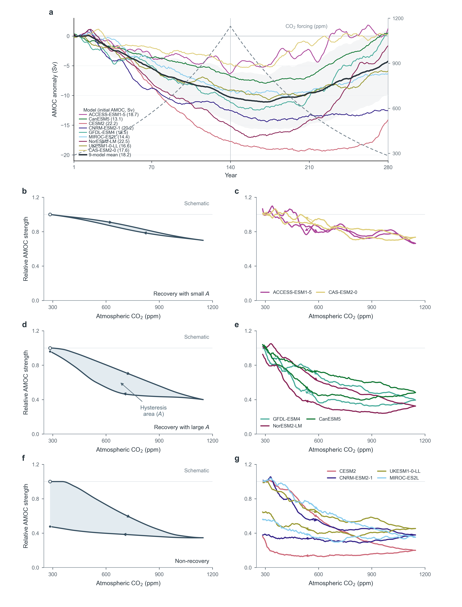

- 绘图代码：`plot/s01_amoc/n80_seven_panel_hysteresis_40n.py`
- 计算代码：`src/s01_amoc/n79_seven_panel_hysteresis_40n.py`
- 计算结果：`output/s01_amoc/n79_seven_panel_hysteresis_40n/`

## Figure2: Stratification, MLD and sea ice

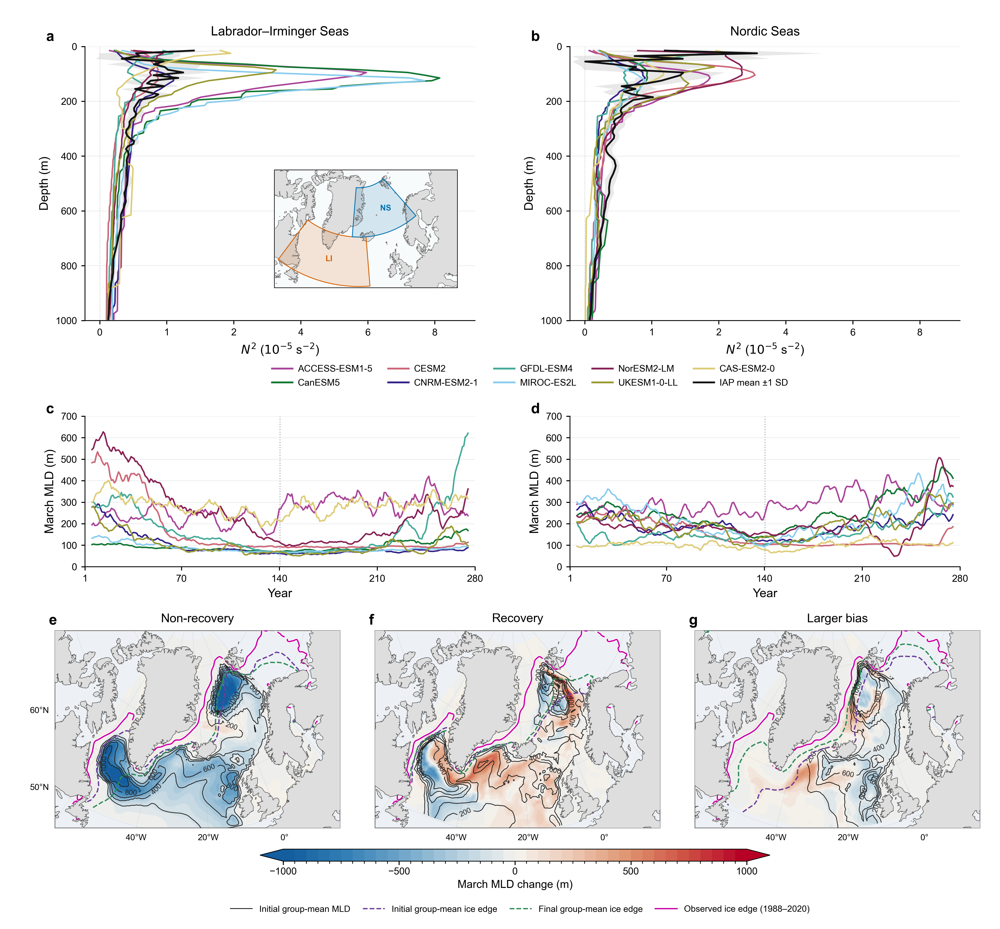

- 绘图代码：`plot/S02_sia/s02_arctic_region/n094_compact_regional_hydrography.py`
- 计算代码：`src/s02_sia/s02_arctic_region/n093_compact_regional_hydrography.py`
- 计算结果：`output/s02_sia/s02_arctic_region/p23_stratification_mld_composite/n093_compact_regional_hydrography/`

## Figure3: EEI decomposition and temperature

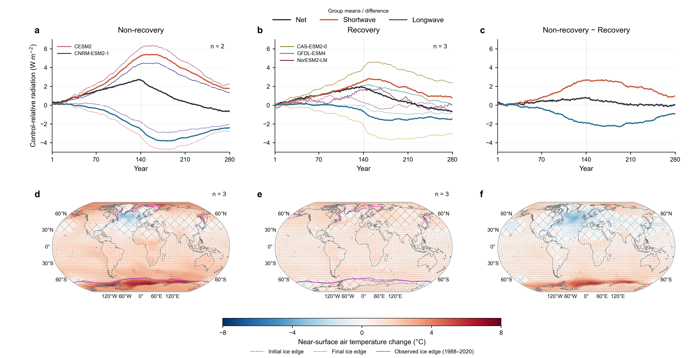

- 绘图代码：`plot/s05_atmosphere/p07_toa_energy_balance/n19_five_model_figure3.py`
- 计算代码：`src/s05_atmosphere/p07_toa_energy_balance/n18_five_model_figure3.py`
- 计算结果：`output/s05_atmosphere/p07_toa_energy_balance/n18_five_model_figure3/`

## Figure4: Atmospheric circulation and net precipitation

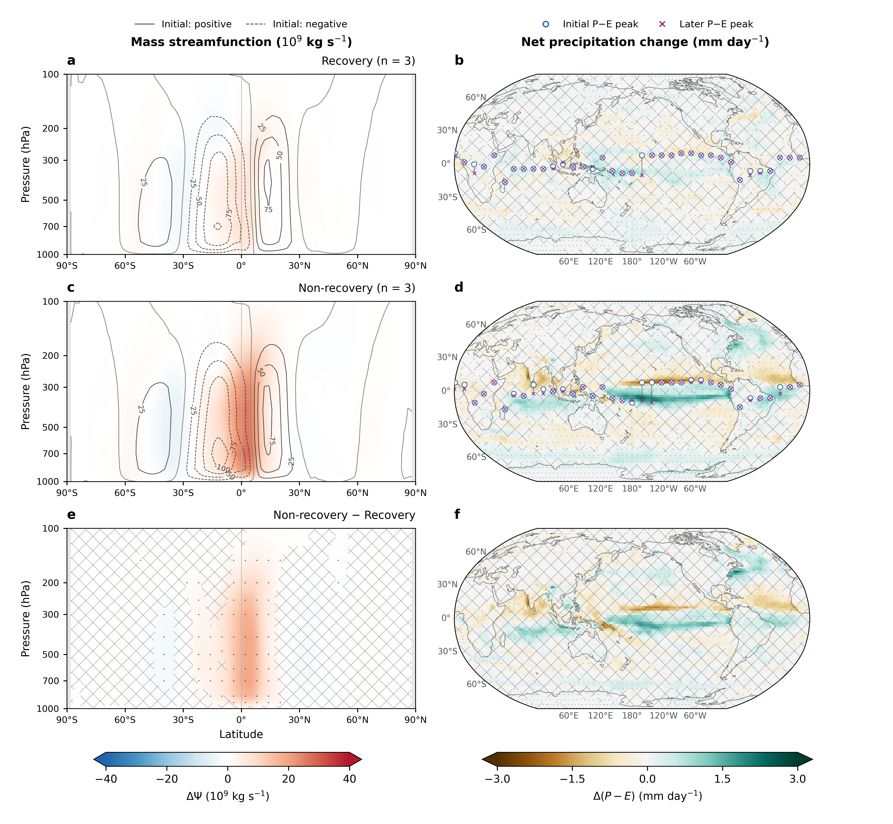

- 绘图代码：`plot/s05_atmosphere/p05_amoc_recovery_composites/n82_six_model_circulation_net_precipitation.py`
- 计算代码：`src/s05_atmosphere/p05_amoc_recovery_composites/n81_six_model_net_precipitation.py`
- 计算结果：`output/s05_atmosphere/p05_amoc_recovery_composites/n81_six_model_net_precipitation/`

## FigureS1: 26.5N AMOC evolution and hysteresis

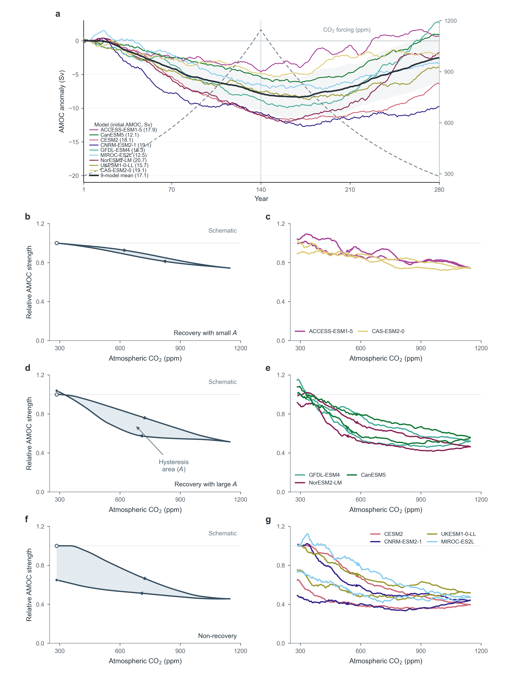

- 绘图代码：`plot/s01_amoc/n78_seven_panel_hysteresis.py`
- 计算代码：`src/s01_amoc/n77_seven_panel_hysteresis.py`
- 计算结果：`output/s01_amoc/n77_seven_panel_hysteresis/`

## FigureS2: Arctic regional tas and sea-ice edges

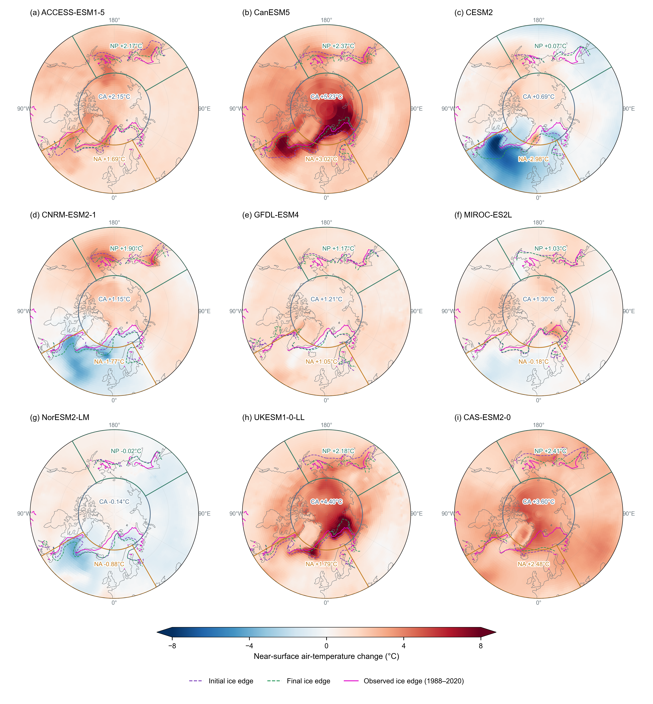

- 绘图代码：`plot/s03_tem/n20_arctic_partition_tas_ice.py`
- 计算代码：`src/s03_tem/n19_arctic_partition_tas_ice.py`
- 计算结果：`output/s03_tem/n19_arctic_partition_tas_ice/`

## FigureS3: Initial MLD: derived minus mlotst

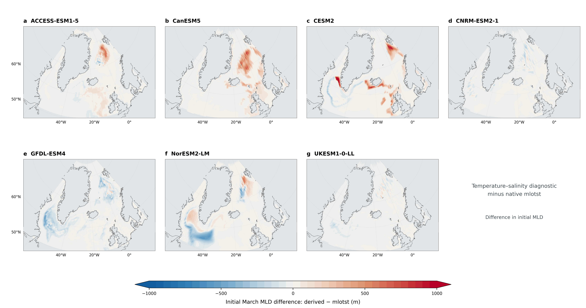

- 绘图代码：`plot/S02_sia/s02_arctic_region/n096_mld_method_difference_patterns.py`
- 计算代码：`src/s02_sia/s02_arctic_region/n095_mld_method_difference_patterns.py`
- 计算结果：`output/s02_sia/s02_arctic_region/p24_mld_method_comparison/n095_mld_method_difference_patterns/`

## FigureS4: Final MLD: derived minus mlotst

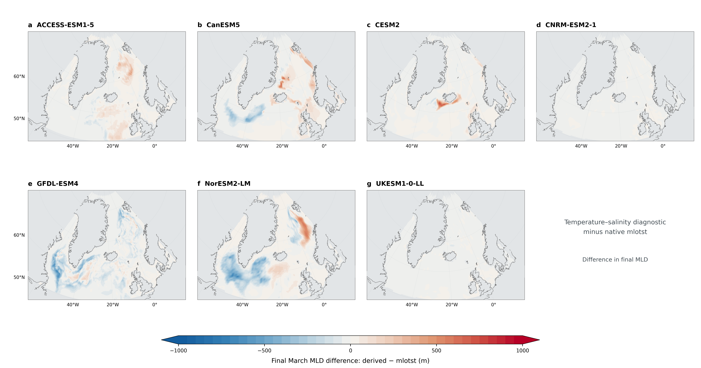

- 绘图代码：`plot/S02_sia/s02_arctic_region/n096_mld_method_difference_patterns.py`
- 计算代码：`src/s02_sia/s02_arctic_region/n095_mld_method_difference_patterns.py`
- 计算结果：`output/s02_sia/s02_arctic_region/p24_mld_method_comparison/n095_mld_method_difference_patterns/`

## FigureS5: MLD residual response: derived minus mlotst

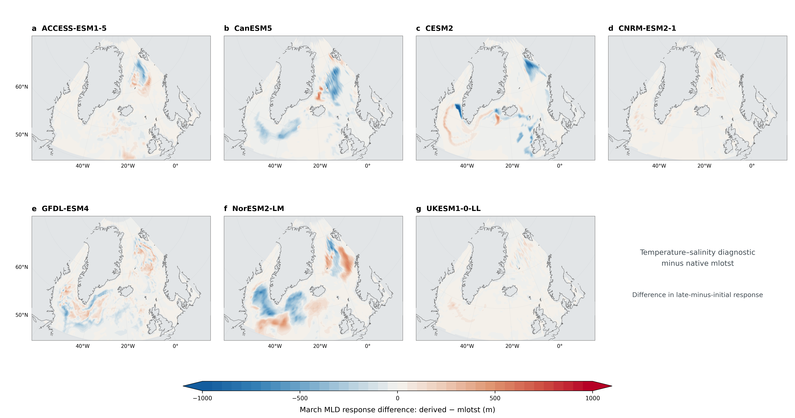

- 绘图代码：`plot/S02_sia/s02_arctic_region/n096_mld_method_difference_patterns.py`
- 计算代码：`src/s02_sia/s02_arctic_region/n095_mld_method_difference_patterns.py`
- 计算结果：`output/s02_sia/s02_arctic_region/p24_mld_method_comparison/n095_mld_method_difference_patterns/`

## FigureS6: Nine-model AMOC 40N/65N decomposition below500m

- 绘图代码：`plot/s01_amoc/n02_amocdeta9model.py`
- 计算代码：`src/s01_amoc/n05_amoc4065deta.py`
- 计算结果：`output/amoc_s01_n01/n12_deepwater_regions_500m/`

## FigureS7: Three-versus-three P, E and P-E

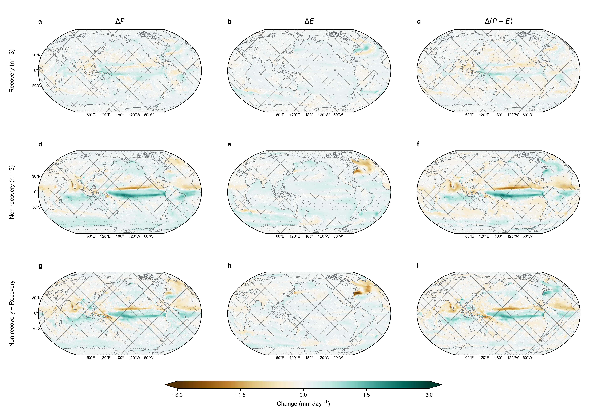

- 绘图代码：`plot/s05_atmosphere/p05_amoc_recovery_composites/n87_three_by_three_hydrology.py`
- 计算代码：`src/s05_atmosphere/p05_amoc_recovery_composites/n86_three_by_three_hydrology.py`
- 计算结果：`output/s05_atmosphere/p05_amoc_recovery_composites/n86_three_by_three_hydrology/`

## FigureS8: Nine-model global tas280-year evolution

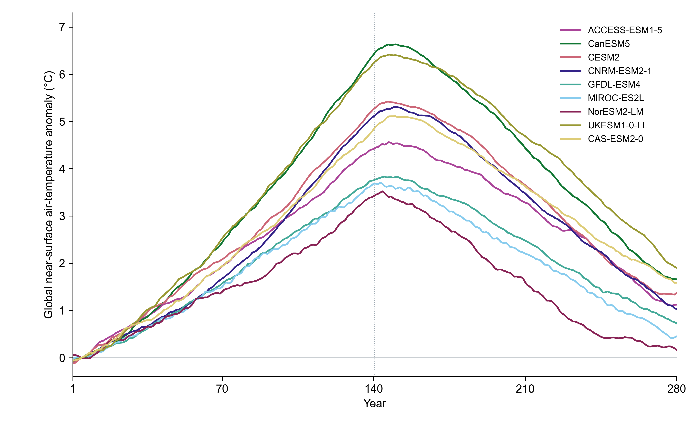

- 绘图代码：`plot/s03_tem/n18_nine_model_global_tas_series.py`
- 计算代码：`src/s03_tem/n17_nine_model_global_tas_series.py`
- 计算结果：`output/s03_tem/n17_nine_model_global_tas_series/`

